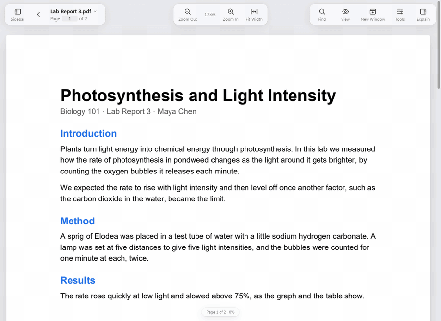

# Letters

A desktop PDF editor and office suite for students, for Windows and macOS.
Every tool is explained in plain English, nothing leaves your computer
unless you turn something on and are told first, and a 500 page file
should feel the same as a 5 page one.



*A lab report opened, searched for "light", and a sentence added to a
paragraph in the PDF's own font, then saved. Recorded from the real app on
Windows 11 ([MP4](docs/media/pdf-editor-demo.mp4)).*

## Download

Get the installer for your computer from the
[Releases page](https://github.com/phonehseng/Letters/releases):

| Computer | File | What it does |
|---|---|---|
| Windows 10 or 11 | `Letters_x.y.z_x64-setup.exe` | Installs for you alone, without administrator rights. It carries everything Letters needs: the PDF engine, text recognition (Tesseract with English), the fonts, and WebView2 if your computer lacks it. |
| macOS 11 or later, Apple or Intel | `Letters_x.y.z_universal.dmg` | Open it and drag Letters to Applications. |

Letters isn't code-signed yet. Windows shows "Windows protected your PC":
choose **More info**, then **Run anyway**. macOS asks you to allow it once
in **System Settings › Privacy & Security**.

Two things are optional and found on their own if you have them:
Microsoft Office or the free [LibreOffice](https://www.libreoffice.org)
lets Letters turn Word, Excel and PowerPoint files into PDFs that look the
way those programs lay them out. Without either, Letters still opens,
edits and saves those files itself.

## What it does

**PDFs**

- Read fast: pages are drawn in tiles, the ones you are looking at first.
- Edit the page's own text and pictures, in the PDF's own fonts, rather
  than covering it with a box.
- Mark up: highlights, notes, drawing, shapes, stamps.
- Pages: reorder, rotate, insert, extract, split and merge.
- Forms: fill in, build your own with totals, formats and checks, and
  export the answers.
- Sign: signatures that stay valid after a field is filled in, trusted
  time stamps, certifying, and an audit trail.
- Redact for real, password-protect, and remove hidden information.
- Text recognition for scans, so they can be searched and copied.
- Compare two versions, PDF/A for archives, accessibility checks.

**Converting**

- PDF to Word with nothing moved: the exact converter keeps every line
  where it was, measured to within 1/100 of a point on 12 of its 13 test documents,
  so a line or two can be added to a corporate PDF without changing its
  spacing, colours or fonts.
- An "easy to edit" Word export when you'd rather have flowing text.
- Word, OpenDocument, RTF and pictures to and from PDF.

**Writing, sheets, slides and code**

- A writer for Word and OpenDocument files.
- Spreadsheets with Excel's shortcuts, formulas and tips.
- A slide editor for PowerPoint and OpenDocument presentations.
- A code editor for the code and text files handed in with a report, with
  checks for HTML, CSS, JSON, JavaScript and more. Nothing is ever run.

**Finding things**

- Search across every document in a folder, inside PDFs, Word files and
  sheets, without anything leaving the computer.
- Organise files: rename, move and tidy them from inside Letters.

The full list of what works, with measurements, is in
[CHANGELOG.md](CHANGELOG.md). [ARCHITECTURE.md](ARCHITECTURE.md) explains
how it is put together, [docs/DESIGN.md](docs/DESIGN.md) the design rules,
and [docs/PRIVACY.md](docs/PRIVACY.md) what stays on your computer.

## Status

Letters is young. It is built and tested every day on Windows 11; the
tests also run on macOS and Linux in CI, but the Mac app itself hasn't
been tried by a person yet. Known problems are tracked in
[the issues](https://github.com/phonehseng/Letters/issues). Reports are
welcome, and [docs/CONTRIBUTING.md](docs/CONTRIBUTING.md) explains how
changes land.

## Building it yourself

### What you need

| | Windows | macOS |
|---|---|---|
| Rust (stable) | [rustup.rs](https://rustup.rs) | [rustup.rs](https://rustup.rs) |
| Node.js, current LTS | [nodejs.org](https://nodejs.org) | [nodejs.org](https://nodejs.org) |
| C toolchain | see below | `xcode-select --install` |
| Web view | WebView2 (already part of Windows 11) | built in |

**Windows C toolchain.** Either works:

- *Visual Studio Build Tools* with "Desktop development with C++" (needs
  administrator rights), with Rust's default `msvc` toolchain; or
- *MinGW-w64* from [winlibs.com](https://winlibs.com) unpacked anywhere and
  added to `PATH` (no administrator rights), with
  `rustup default stable-x86_64-pc-windows-gnu`.

### Build and run

From the repository root:

**Windows (PowerShell)**

```powershell
.\tools\fetch-pdfium.ps1     # once: downloads the pdf engine into vendor\pdfium
npm install                  # once: installs the build tools and the ui's packages
npm run dev                  # runs the app and reloads the ui when you edit it
```

**macOS**

```sh
sh tools/fetch-pdfium.sh
npm install
npm run dev
```

Other commands:

| Command | What it does |
|---|---|
| `npm test` | runs the Rust tests and the UI tests |
| `npm run check` | runs the linters (clippy and svelte-check) |
| `npx tauri build --no-bundle` | builds the optimised program, `target/release/letters` |

The Rust tests need the PDF engine, so run the fetch script first.

The app is built and run every day on Windows 11 with the MinGW
toolchain; CI builds and tests it on Windows, macOS and Linux.

## Packaging

The installers come from `npx tauri build`, run in `app/shell`. Before it,
fill in the shipped resources once:

```powershell
.\tools\fetch-pdfium.ps1            # the pdf engine (vendor\pdfium)
.\tools\fetch-tesseract.ps1         # text recognition (vendor\tesseract)
.\tools\fetch-fonts.ps1             # bundled open fonts (vendor\fonts)
powershell -ExecutionPolicy Bypass -File tools\icon\make-document-icons.ps1
node tools\licenses\make-third-party-licenses.mjs   # THIRD-PARTY-LICENSES.txt, and what needs review
```

| System | Command | Result |
|---|---|---|
| Windows | `cd app\shell; npx tauri build` | `target\release\bundle\nsis\Letters_0.1.0_x64-setup.exe`: a per-user installer (no administrator rights) that registers Letters for PDF, Word, OpenDocument, RTF and picture files and lists it in Settings > Apps > Default apps |
| macOS | `cd app/shell && npx tauri build` | `target/release/bundle/macos/Letters.app` and `target/release/bundle/dmg/Letters_0.1.0_aarch64.dmg`, with the same document types in the app's Info.plist |

Tauri's bundler downloads NSIS (Windows) the first time. The file types,
icons, installer mode and macOS settings are in `app/shell/tauri.conf.json`
(`bundle`); `app/shell/installer-hooks.nsh` adds the document icons and the
Default Apps entry on Windows.

**Making Letters the default app.** No app may make itself the default:
the installer tells the system which files Letters opens, and the person
picks it. On Windows: Settings > Privacy in Letters has Open Default Apps
Settings…, where Letters can be chosen for each type. On a Mac: select a
file in the Finder, File > Get Info, choose Letters under "Open with", then
Change All.

### What to run on Windows, and what to send back

What could not be checked here because it would change this computer:

1. Run `Letters_0.1.0_x64-setup.exe`. Send: whether it asked for
   administrator rights (it should not), and the folder it installed to
   (`%LOCALAPPDATA%\Letters` expected).
2. In Explorer, look at a .pdf, .docx and .png file. Send a screenshot of
   their icons (Letters' document icons appear only once Letters is the
   default for that type).
3. In Settings > Apps > Default apps, search "Letters". Send a screenshot
   of its page (the list of file types it can open).
4. Double click a PDF and a Word document with Letters set as default, then
   select three PDFs in Explorer and press Enter. Send: how many windows
   opened.
5. Uninstall from Settings > Apps. Send the output of
   `reg query HKCU\Software\Letters /s` and
   `reg query HKCU\Software\RegisteredApplications /v Letters` (both should
   say nothing is found).

### What to run on macOS, and what to send back

Nothing for macOS could be built or run here. On the Mac:

1. `xcode-select --install`, install Rust and Node, then from the
   repository root: `sh tools/fetch-pdfium.sh && sh tools/fetch-tesseract.sh && sh tools/fetch-fonts.sh && npm install`.
2. `node tools/licenses/make-third-party-licenses.mjs`
3. `cd app/shell && npx tauri build 2>&1 | tee ~/letters-build.log`.
   Send `~/letters-build.log` (or its last 100 lines if it is long).
4. `plutil -p target/release/bundle/macos/Letters.app/Contents/Info.plist`.
   Send the output (CFBundleDocumentTypes should list the twelve types).
5. `codesign -dv target/release/bundle/macos/Letters.app 2>&1` and
   `spctl -a -vv target/release/bundle/macos/Letters.app 2>&1`. Send both
   (the app is not signed or notarized yet; this shows what Gatekeeper says).
6. Open the .dmg, drag Letters to Applications, open it (right click >
   Open the first time). Then in the Finder: a PDF > Get Info > Open with >
   Letters > Change All, and double click two PDFs and a .docx. Send: a
   screenshot of the Get Info window, and whether each opened in its own
   window.
7. Letters > Settings… (Command ,): send a screenshot, and one of
   File > Export To… (Command Shift E) with a PDF open.

## Where things are

```
app/shell        the desktop program: windows, file opening, the bridge to the ui
app/shell-core   the parts of the shell that can be tested without a window
app/ui           the interface (Svelte + TypeScript)
core/pdf         opens pdfs and renders pages as tiles (pdfium)
core/edit        changing a page's own text and pictures
core/exact       the exact pdf to word converter
core/convert     conversion and export, office files to pdf
core/office      word, opendocument and rtf documents (the writer)
core/sheets      spreadsheets: cells, formulas, xlsx and ods
core/slides      presentations: pptx and odp
core/forms       form fields, form logic, signing and the audit trail
core/standards   pdf/a, preflight and print checks
core/...         annotate, redact, pages, compare, ocr, search, a11y,
                 fonts, layout, ai
docs             design notes, accessibility, privacy, worklogs
tools            fetch scripts, the licence list, mac word checks, icons
```

## License

Letters is licensed under either the Apache License 2.0 (`LICENSE-APACHE`)
or the MIT license (`LICENSE-MIT`), at your option. See `LICENSE`.

## Libraries and their licenses

Every library the packaged app is made from is listed, with its license
text, in `THIRD-PARTY-LICENSES.txt`, which `tauri build` writes afresh each
time. The main ones:

| Library | Used for | License |
|---|---|---|
| [PDFium](https://pdfium.googlesource.com/pdfium/) (prebuilt by [pdfium-binaries](https://github.com/bblanchon/pdfium-binaries)) | reading and drawing PDFs | Apache-2.0 |
| [pdfium-render](https://crates.io/crates/pdfium-render) | Rust bindings to PDFium | MIT or Apache-2.0 |
| [Tauri](https://tauri.app) | windows, packaging | MIT or Apache-2.0 |
| [Svelte](https://svelte.dev), [Vite](https://vite.dev) | the interface | MIT |
| [png](https://crates.io/crates/png), [serde](https://serde.rs), [thiserror](https://crates.io/crates/thiserror) | small helpers | MIT or Apache-2.0 |

Nothing here restricts distributing the app. MuPDF, Ghostscript and Poppler
are deliberately not used, because their AGPL/GPL licenses would.
