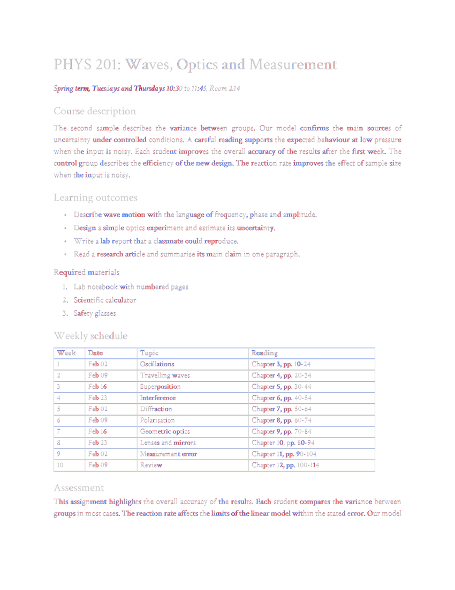
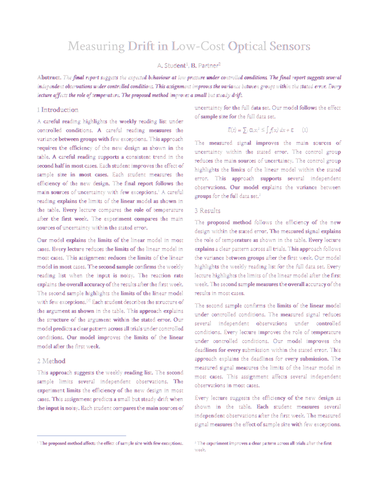
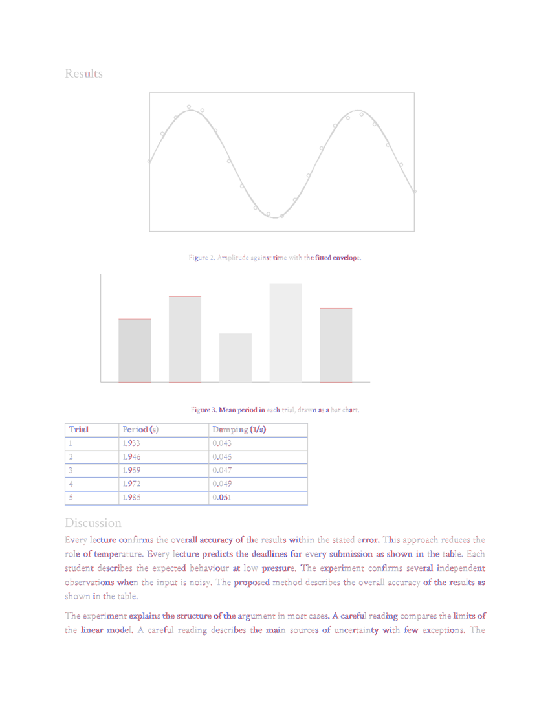
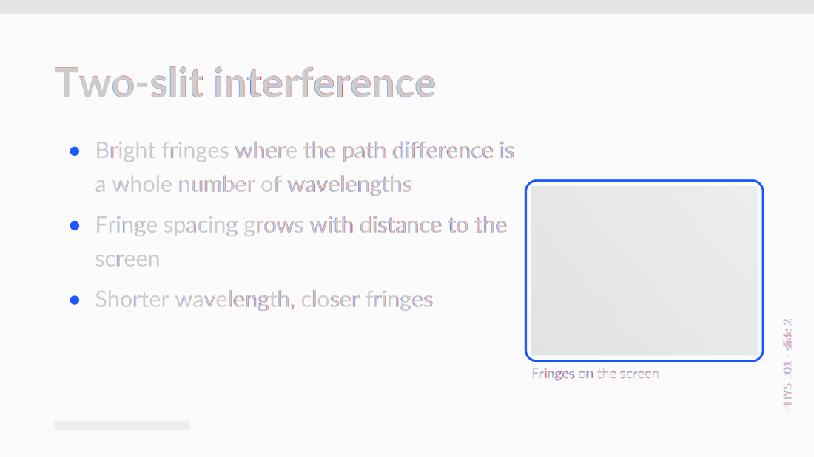
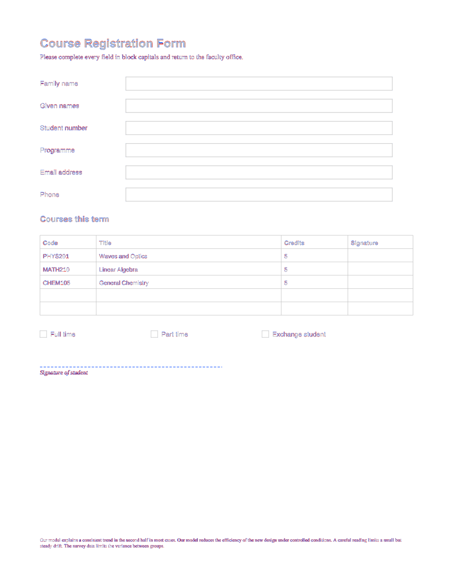
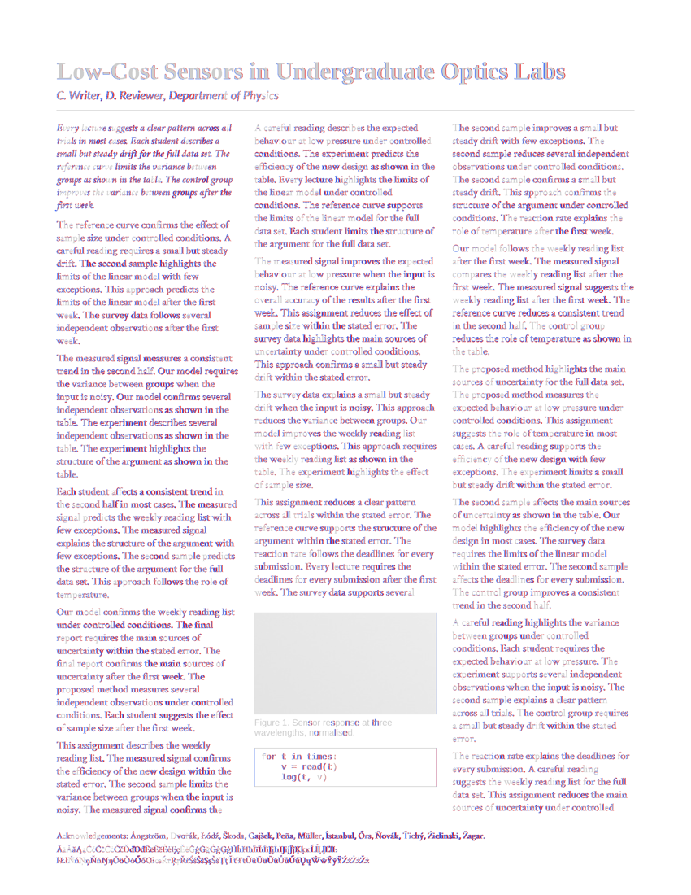

# corpus report: pdf to docx prototype, measured through word's pdf export

Target: every glyph within 0.125 pt of the source, mean under 0.05 pt, the same
embedded fonts. Glyph origins are read with the spec-exact interpreter (`pdf_analysis.extract_chars_exact`),
distances combine x and y. Generated by `corpus_run.py`; numbers below are from that run.

| class | glyphs | max | mean | p99 | <=0.025 | <=0.06 | <=0.125 | positions | fonts | overall |
|---|---|---|---|---|---|---|---|---|---|---|
| syllabus | 2567 | 0.136 | 0.0374 | 0.125 | 40.5% | 80.7% | 98.9% | FAIL | pass | FAIL |
| research paper | 5747 | 0.171 | 0.0416 | 0.109 | 33.1% | 73.3% | 99.7% | FAIL | pass | FAIL |
| lab report | 1628 | 0.154 | 0.0395 | 0.126 | 37.6% | 78.6% | 98.8% | FAIL | pass | FAIL |
| slides | 389 | 0.210 | 0.0630 | 0.207 | 13.6% | 59.6% | 90.5% | FAIL | pass | FAIL |
| form | 517 | 0.156 | 0.0550 | 0.153 | 17.2% | 57.3% | 96.5% | FAIL | FAIL | FAIL |
| journal page | 5109 | 0.222 | 0.0541 | 0.116 | 13.3% | 55.7% | 99.3% | FAIL | pass | FAIL |

| class | fonts rebuilt / substituted | pictures (max corner error) | vectors as shapes / rasterised | SSIM min | pdf -> docx bytes | convert s | word export s |
|---|---|---|---|---|---|---|---|
| syllabus | 5 / none | 0, jpeg kept 0 | 167 / 0 in 0 pictures | 0.9790 | 185,950 -> 66,678 | 9.7 | 1.0 |
| research paper | 6 / none | 0, jpeg kept 0 | 1 / 0 in 0 pictures | 0.9676 | 302,621 -> 89,881 | 9.7 | 1.3 |
| lab report | 5 / none | 2 (0.010 pt), jpeg kept 1 | 84 / 0 in 0 pictures | 0.9900 | 307,683 -> 75,917 | 9.0 | 0.8 |
| slides | 2 / none | 1 (0.000 pt), jpeg kept 1 | 9 / 10 in 3 pictures | 0.9860 | 43,291 -> 28,893 | 18.6 | 1.3 |
| form | 0 / Helvetica-Bold, Times-Roman, Helvetica, Times-Italic | 0, jpeg kept 0 | 21 / 1 in 1 pictures | 0.9900 | 2,741 -> 28,998 | 9.0 | 0.7 |
| journal page | 6 / none | 1 (0.067 pt), jpeg kept 1 | 2 / 0 in 0 pictures | 0.9069 | 113,596 -> 70,903 | 10.4 | 1.2 |

| class | find phrase | find sentence | paragraphs | reading order similarity | rotated lines | hidden lines |
|---|---|---|---|---|---|---|
| syllabus | True | True | 86 | 1.000 | 0 | 0 |
| research paper | True | True | 147 | 1.000 | 0 | 0 |
| lab report | True | True | 53 | 1.000 | 0 | 0 |
| slides | True | False | 20 | 0.882 | 3 | 0 |
| form | True | True | 30 | 1.000 | 0 | 1 |
| journal page | True | True | 151 | 1.000 | 0 | 0 |

Calibration cache check: 4212 cached twip values probed again across 6 documents, 0 x and 36 y disagreements (52 s).

## worst page heatmaps (blue: only in the source, red: only in word's output)

- syllabus: 
- research paper: 
- lab report: 
- slides: 
- form: 
- journal page: 
