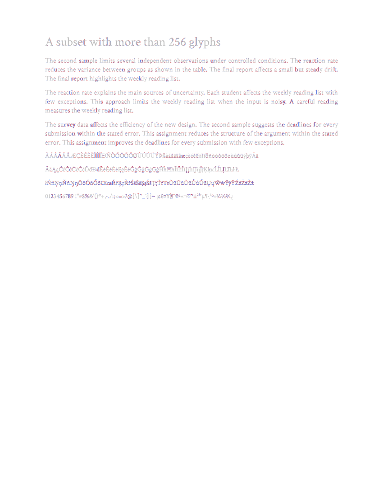
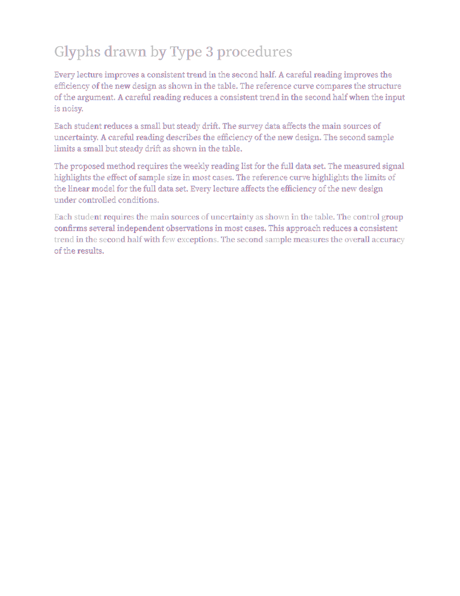
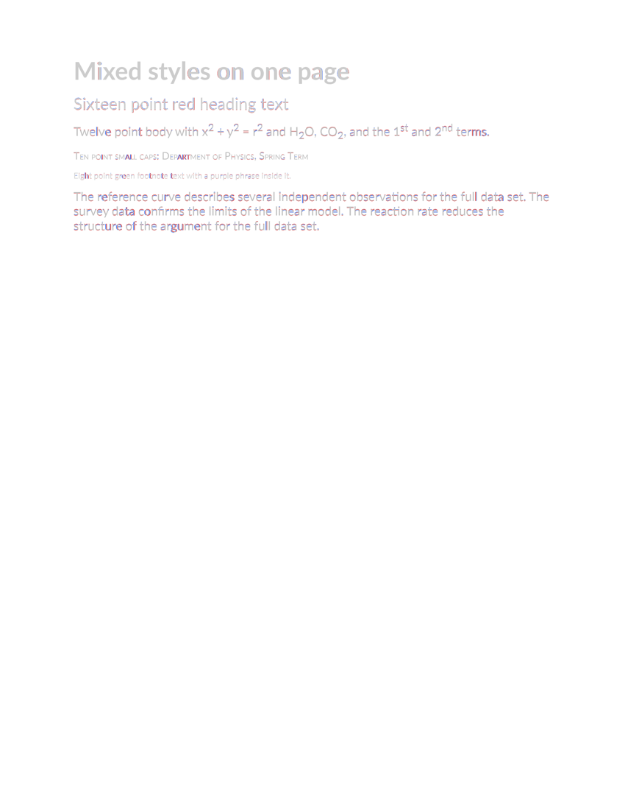
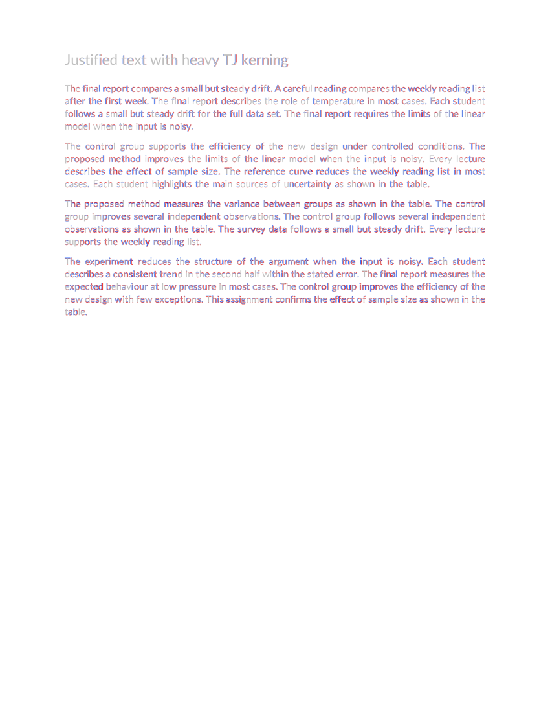
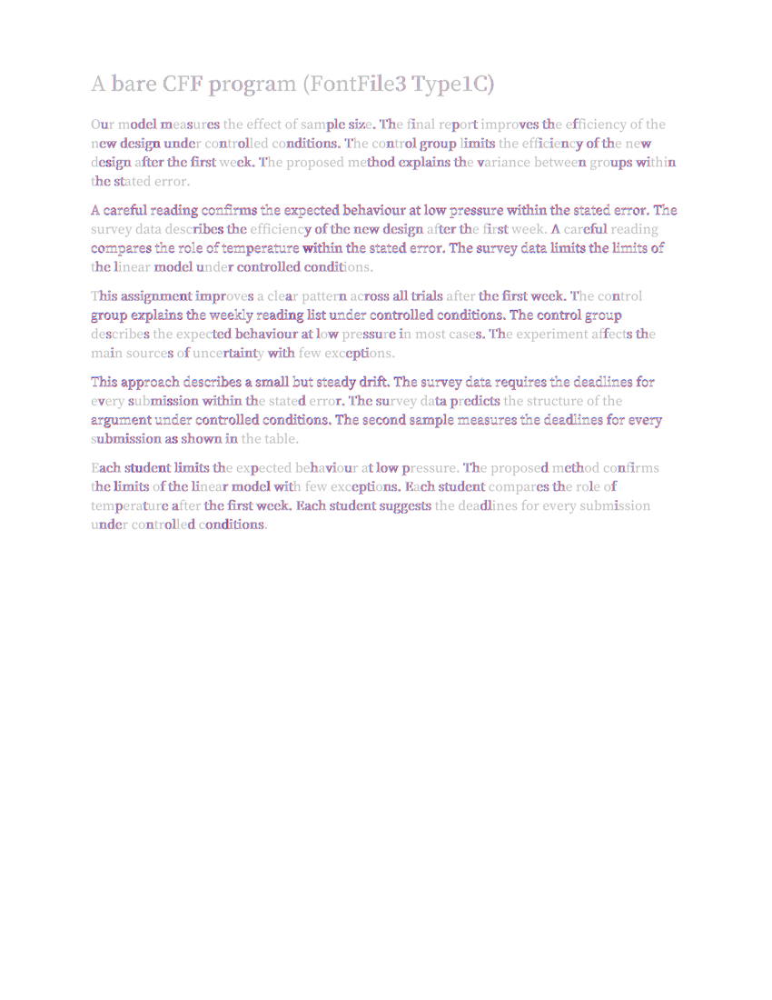
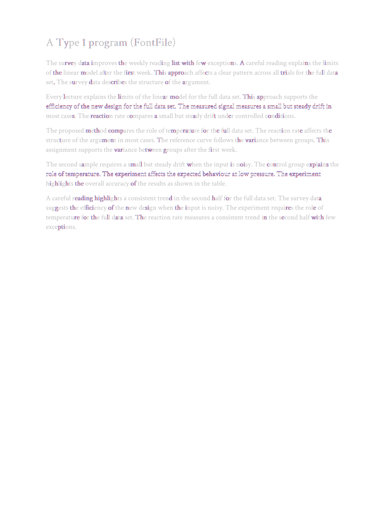
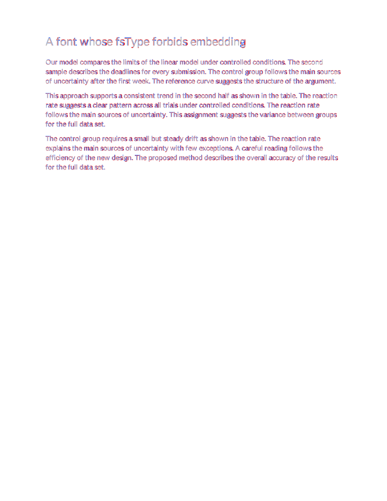

# corpus report: pdf to docx prototype, measured through word's pdf export

Target: every glyph within 0.125 pt of the source, mean under 0.05 pt, the same
embedded fonts. Glyph origins are read with the spec-exact interpreter (`pdf_analysis.extract_chars_exact`),
distances combine x and y. Generated by `corpus_run.py`; numbers below are from that run.

| class | glyphs | max | mean | p99 | <=0.025 | <=0.06 | <=0.125 | positions | fonts | overall |
|---|---|---|---|---|---|---|---|---|---|---|
| syllabus | 2567 | 0.074 | 0.0278 | 0.059 | 46.5% | 100.0% | 100.0% | pass | pass | pass |
| research paper | 5747 | 0.063 | 0.0312 | 0.059 | 37.4% | 99.9% | 100.0% | pass | pass | pass |
| lab report | 1628 | 0.063 | 0.0285 | 0.060 | 45.1% | 99.9% | 100.0% | pass | pass | pass |
| slides | 389 | 0.102 | 0.0494 | 0.095 | 13.9% | 67.6% | 100.0% | pass | pass | pass |
| form | 517 | 0.085 | 0.0447 | 0.083 | 18.0% | 71.2% | 100.0% | pass | FAIL | FAIL |
| journal page | 5109 | 0.086 | 0.0496 | 0.083 | 13.4% | 63.8% | 100.0% | pass | pass | pass |
| cid subset > 256 glyphs | 972 | 0.078 | 0.0427 | 0.077 | 17.9% | 84.6% | 100.0% | pass | pass | pass |
| Type 3 font | 972 | 0.078 | 0.0416 | 0.076 | 21.0% | 86.5% | 100.0% | pass | pass | pass |
| mixed styles | 387 | 0.077 | 0.0403 | 0.073 | 21.2% | 89.1% | 100.0% | pass | pass | pass |
| justified TJ kerning | 1230 | 0.084 | 0.0479 | 0.082 | 13.9% | 67.8% | 100.0% | pass | pass | pass |
| CFF font | 1338 | 0.085 | 0.0485 | 0.082 | 13.2% | 68.8% | 100.0% | pass | pass | pass |
| Type 1 font | 1255 | 0.085 | 0.0490 | 0.083 | 11.9% | 66.5% | 100.0% | pass | pass | pass |
| restricted fsType | 785 | 0.085 | 0.0471 | 0.084 | 18.9% | 64.1% | 100.0% | pass | FAIL | FAIL |

Against round 3 (`corpus_report_round3.json`) and the lattice floor (`prototype/floor.py`: each source
glyph's distance to the nearest position word can print, the best any plan can reach):

| class | round 3 max / mean | round 4 max / mean | floor max / mean | floor x mean / y mean | glyphs off plan after checking |
|---|---|---|---|---|---|
| syllabus | 0.136 / 0.0374 | 0.074 / 0.0278 | 0.074 / 0.0278 | 0.0278 / 0.0000 | 0 |
| research paper | 0.171 / 0.0416 | 0.063 / 0.0312 | 0.063 / 0.0312 | 0.0312 / 0.0000 | 0 |
| lab report | 0.154 / 0.0395 | 0.063 / 0.0285 | 0.063 / 0.0285 | 0.0285 / 0.0000 | 0 |
| slides | 0.210 / 0.0630 | 0.102 / 0.0494 | 0.083 / 0.0447 | 0.0310 / 0.0280 | 0 |
| form | 0.156 / 0.0550 | 0.085 / 0.0447 | 0.085 / 0.0447 | 0.0281 / 0.0292 | 0 |
| journal page | 0.222 / 0.0541 | 0.086 / 0.0496 | 0.086 / 0.0496 | 0.0300 / 0.0350 | 0 |
| cid subset > 256 glyphs | new | 0.078 / 0.0427 | 0.078 / 0.0427 | 0.0306 / 0.0254 | 0 |
| Type 3 font | new | 0.078 / 0.0416 | 0.078 / 0.0416 | 0.0303 / 0.0239 | 0 |
| mixed styles | new | 0.077 / 0.0403 | 0.077 / 0.0403 | 0.0303 / 0.0219 | 0 |
| justified TJ kerning | new | 0.084 / 0.0479 | 0.084 / 0.0479 | 0.0294 / 0.0336 | 0 |
| CFF font | new | 0.085 / 0.0485 | 0.085 / 0.0485 | 0.0301 / 0.0336 | 0 |
| Type 1 font | new | 0.085 / 0.0490 | 0.085 / 0.0490 | 0.0294 / 0.0355 | 0 |
| restricted fsType | new | 0.085 / 0.0471 | 0.085 / 0.0471 | 0.0305 / 0.0312 | 0 |

| class | fonts rebuilt / substituted | pictures (max corner error) | vectors as shapes / rasterised | SSIM min | pdf -> docx bytes | convert s | word export s |
|---|---|---|---|---|---|---|---|
| syllabus | 5 / none | 0, jpeg kept 0 | 167 / 0 in 0 pictures | 0.9808 | 185,950 -> 69,765 | 12.2 | 1.4 |
| research paper | 6 / none | 0, jpeg kept 0 | 1 / 0 in 0 pictures | 0.9726 | 302,621 -> 95,154 | 13.5 | 1.5 |
| lab report | 5 / none | 2 (0.010 pt), jpeg kept 1 | 84 / 0 in 0 pictures | 0.9906 | 307,683 -> 77,902 | 12.1 | 1.0 |
| slides | 2 / none | 1 (0.000 pt), jpeg kept 1 | 9 / 10 in 3 pictures | 0.9872 | 43,291 -> 29,559 | 76.0 | 1.5 |
| form | 0 / Helvetica-Bold, Times-Roman, Helvetica, Times-Italic | 0, jpeg kept 0 | 21 / 1 in 1 pictures | 0.9897 | 2,741 -> 29,350 | 7.8 | 0.8 |
| journal page | 6 / none | 1 (0.067 pt), jpeg kept 1 | 2 / 0 in 0 pictures | 0.9086 | 113,596 -> 75,266 | 29.5 | 1.4 |
| cid subset > 256 glyphs | 1 / none | 0, jpeg kept 0 | 0 / 0 in 0 pictures | 0.9942 | 41,018 -> 86,412 | 9.3 | 0.8 |
| Type 3 font | 2 / none | 0, jpeg kept 0 | 0 / 0 in 0 pictures | 0.9937 | 19,904 -> 18,706 | 16.5 | 0.8 |
| mixed styles | 2 / none | 0, jpeg kept 0 | 0 / 0 in 0 pictures | 0.9978 | 24,204 -> 31,667 | 15.0 | 1.0 |
| justified TJ kerning | 1 / none | 0, jpeg kept 0 | 0 / 0 in 0 pictures | 0.9733 | 341,639 -> 17,375 | 13.4 | 1.3 |
| CFF font | 1 / none | 0, jpeg kept 0 | 0 / 0 in 0 pictures | 0.9760 | 89,735 -> 18,033 | 11.8 | 0.9 |
| Type 1 font | 1 / none | 0, jpeg kept 0 | 0 / 0 in 0 pictures | 0.9917 | 15,164 -> 22,125 | 14.6 | 1.0 |
| restricted fsType | 0 / LettersLockedSans-Regular | 0, jpeg kept 0 | 0 / 0 in 0 pictures | 0.9666 | 339,545 -> 13,189 | 19.9 | 1.8 |

| class | find phrase | find sentence | paragraphs | reading order similarity | rotated lines | hidden lines |
|---|---|---|---|---|---|---|
| syllabus | True | True | 86 | 1.000 | 0 | 0 |
| research paper | True | True | 147 | 1.000 | 0 | 0 |
| lab report | True | True | 53 | 1.000 | 0 | 0 |
| slides | True | False | 20 | 0.882 | 3 | 0 |
| form | True | True | 30 | 1.000 | 0 | 1 |
| journal page | True | True | 151 | 1.000 | 0 | 0 |
| cid subset > 256 glyphs | True | None | 15 | 0.964 | 0 | 0 |
| Type 3 font | True | None | 17 | 0.990 | 0 | 0 |
| mixed styles | True | None | 23 | 0.978 | 0 | 0 |
| justified TJ kerning | True | None | 19 | 1.000 | 0 | 0 |
| CFF font | True | None | 22 | 1.000 | 0 | 0 |
| Type 1 font | True | None | 18 | 1.000 | 0 | 0 |
| restricted fsType | True | None | 13 | 1.000 | 0 | 0 |

Calibration cache check: 21 cached facts (writer step tables and baseline offset tables) measured again for 13 documents, 0 disagreements (295 s).

## worst page heatmaps (blue: only in the source, red: only in word's output)

- syllabus: 
- research paper: 
- lab report: 
- slides: 
- form: 
- journal page: 
- cid subset > 256 glyphs: 
- Type 3 font: 
- mixed styles: 
- justified TJ kerning: 
- CFF font: 
- Type 1 font: 
- restricted fsType: 
